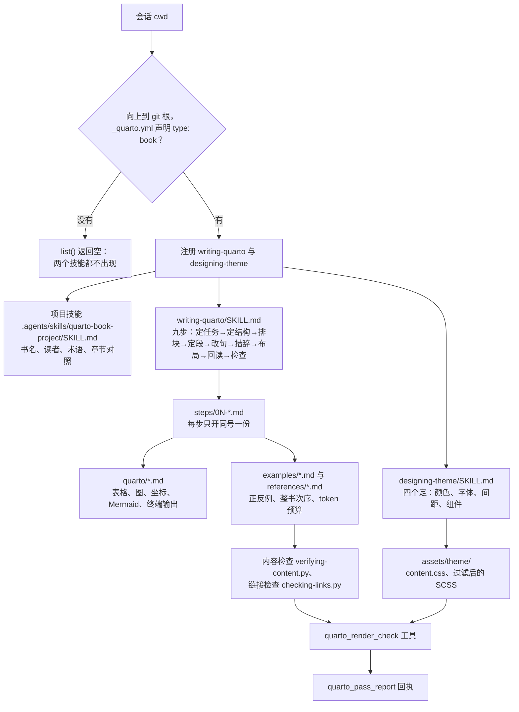

# 插件架构

这个包有两个技能、两个工具、一份工作区门禁。没有共享层：通用写法留在 `writing-quarto`，主题规则留在 `designing-theme`，两侧都需要的只有「章节路径由 `_quarto.yml` 决定」这一条事实，由写作技能引用一次。

## 数据流

门禁只认 git 根上的 `_quarto.yml`，所以这个插件在 C++ 仓库里完全静默；两个技能在门禁之后并列，一次改动同时碰到正文与主题时先改主题再改正文，最后统一走渲染检查。

## 四个写作域

`writing-quarto` 的九步按「写什么、放哪里、怎么排、怎么润」四类改动重排入口：写作域落在第 1–2 步，布局落在第 3–4 步与第 7 步，润色落在第 5–6 步与第 8 步，排版交给 `designing-theme` 的四个定；第 9 步是统一的检查与渲染出口，不属于任何写作域。域只决定入口，不新增加载层：每域仍落到现有步骤与条文，`quarto/` 不按域建子目录，避免同一事实出现两份路径。

四域与九步、条文的对应表只写在 `skills/writing-quarto/SKILL.md` 的「九步」小节，本页不复制；改那张表时只改 `SKILL.md`。

## 四层加载

| 层 | 文件 | 何时进上下文 | 预算 |
| --- | --- | --- | --- |
| 常驻元数据 | 两个 `SKILL.md` 的 frontmatter | 每次技能列表查询 | 每个约 100 token |
| 技能正文 | `SKILL.md` 的 H2 各节 | 技能被选中后整篇载入 | 见 `references/token-budget.md` |
| 步骤 | `steps/0N-*.md` | 走到第 N 步时只开同号一份 | 见 `references/token-budget.md` |
| 条文与案例 | `quarto/`、`examples/`、`references/` | 判不准、排错或步骤明确指向时 | 见 `references/token-budget.md` |

`SKILL.md` 的九步表是唯一的路由表：步号、名称、一句话、文件。`quarto/` 与 `examples/` 不自动加载，必须由步骤或 `SKILL.md` 带条件句指向，例如「表格写法见 `quarto/tables.md`」；只写「详见 `quarto/`」不算。整本书的总预算是 140000 token，口径在 `references/token-budget.md`。

## 文件职责

| 路径 | 唯一职责 |
| --- | --- |
| `skills/writing-quarto/SKILL.md` | 触发描述、适用边界、九步路由、跨步不变量 |
| `skills/writing-quarto/` 的 `steps/`、`quarto/`、`examples/`、`references/`、`scripts/` | 各层放什么、怎么新增规则，见 `docs/writing-quarto-layout.md`，本表不重复 |
| `skills/designing-theme/SKILL.md` | 触发描述、四个定、主题文件入口 |
| `skills/designing-theme/references/theme-system.md`、`knowledge/` | 主题变量、层级与源码知识 |
| `skills/designing-theme/assets/theme/` | `content.css` 与 SCSS 层 |
| `templates/quarto-book-project/` | 项目技能模板：书名、读者、术语、章节对照 |
| `src/tools/render-check.ts`、`pass-report.ts` | 工具源码，编译到 `lib/tools/` |
| `docs/architecture.md` | 本页：分层、数据流与文件职责 |
| `docs/plugin-flow.md` | 从安装到回执的五层结构 |
| `docs/plugin-boundaries.md` | 工作区检查的六类情形 |
| `docs/triggering.md` | 触发矩阵与描述维护规则 |
| `docs/writing-quarto-layout.md` | 写作技能的目录分层 |
| `docs/versioning.md` | 版本号与发布顺序 |

同一事实只留一份权威：章节路径在 `_quarto.yml`，术语在项目技能的术语表，表格写法在 `quarto/tables.md`，主题变量在 `theme-system.md`。步骤文件只写「这一步做什么、何时退出」，具体写法一律指向条文。

## 检查

`npm run check` 依次跑构建、`scripts/checking-skill-links.mjs`、`scripts/checking-skill-budget.mjs`、`scripts/checking-package.mjs` 与 `tests/*.test.mjs`。结构检查覆盖本图里的每一层：`SKILL.md` 的 H2 与九步表、步骤文件号与 H1、`quarto/` 与 `examples/` 非空、Markdown 链接可解析、本页存在且被 README 的文档表引用。新增或改名文件时先改本页的文件职责表，再改结构检查，最后改 `docs/plugin-layout.md` 的目录树。
