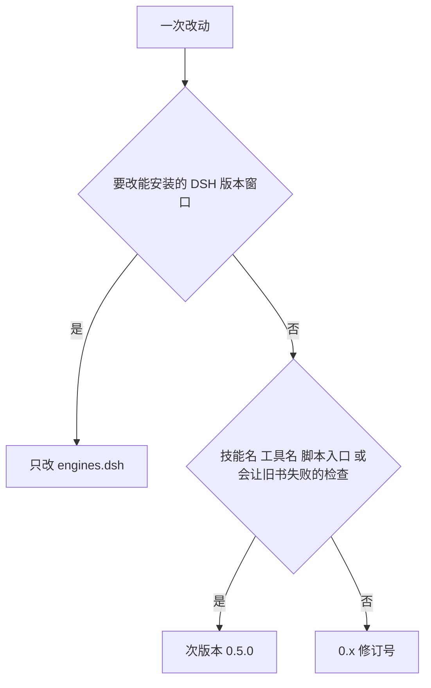

# 版本号与发布顺序

插件自己的版本只有一处：`package.json` 的 `"version"`。`locale/`、两份 `SKILL.md`、`cordis.patch.yml` 都不带版本。

旁边的 `"engines": { "dsh": ">=0.2.0-rc.1 <0.3.0-0" }` 与 peer `@deepseek-ai/dsh-skill` 是宿主兼容范围，表示能装在哪一档 DSH 上。改章节约定、案例或主题措辞时不动它。

## 装上之后怎么看版本

- 命令行：`dsh plugin --profile <profile> list`（等价于在该 profile 里跑 `pnpm list`），读出已解析的包版本。桌面应用跑的是 `desktop` profile，它由应用独占管理，命令行只读不写。
- 磁盘：profile 的 `package.json` 里 `dependencies`，以及 `node_modules/@chengzhao-dev/dsh-quarto-book/package.json` 的 `version`。
- 运行时加载清单：`dsh --profile <profile> --dump-config`，确认 `# == @chengzhao-dev/dsh-quarto-book` 这一层在。官方「设置 → 插件」只显示模块名和启用状态，不显示版本。

README 里的安装命令钉住一次发布：npm 写 `@<版本>`，git 写 `#v<版本>`；`<版本>` 与 `package.json` 的 `version` 一致。不带版本号的 `github:` 地址跟踪默认分支的某次提交，`package.json` 的版本号不会自动变成发布号。

包名与模块名不是一回事：npm 与 profile 依赖里是 `@chengzhao-dev/dsh-quarto-book`，`cordis.patch.yml` 的 `name` 必须与它逐字相同；插件模块导出的 `name` 与技能 provider 的常量仍是短名 `dsh-quarto-book`，技能名与工具名不变。旧的无作用域包 `dsh-quarto-book` 是另一个 npm 坐标，已在迁到作用域包时从 npm 删除；之前装过它的 profile 仍要先 `remove` 再装新包，两份同时留着会以相同的 rank 550 各注册一遍 `writing-quarto` 和 `designing-theme`。

## 三档

版本停在 `0.x`。抬哪一档只看对外契约，不看改了多少字。

- **修订号（`0.4.2`、`0.4.3`…）**：约定措辞、正反例、参考文、README、注释、不改变既有书通过与否的检查词表或提示。以后绝大多数提交走这一档。
- **次版本 `0.5.0`、`0.6.0`，过了 `0.9.0` 是 `0.10.0`、`0.11.0`**：新增技能名或工具名、新增会让旧书失败的检查、脚本命令行不兼容、主题路径或 `_quarto.yml` 接线契约变化、完成判据变成强制步骤。次版本数字一直加，不进位成 `1.0.0`。
- **`1.0.0`**：不做计划内升级。只有维护者明确认定一次特别大的不兼容改动才升；没有这种改动就不升。
- **`engines.dsh`**：只在要支持的 DSH 版本窗口变化时改，与上面三档无关。DSH 进入 `0.3` 时再把上界打开。

同一次改动里若又有措辞又有破坏性检查，取较高的那一档。

## 发布

发布时三处一起动：`package.json` 的 `version`、`package-lock.json` 顶部与 `packages[""]` 的版本、同号的 annotated git tag（如 `0.4.3` 对应 `v0.4.3`）。两份 README 与 `docs/plugin-flow.md` 里的安装命令随版本更新；`SKILL.md` 不再维护一套包版本。

发布走 npm trusted publisher。`0.3.4` 是这个作用域包的首个版本，由本机手工 `npm publish` 引导，同时登记了关联（仓库 `chengzhao-dev/dsh-quarto-book`、文件 `publish.yml`、动作 `npm publish`）；`0.3.5` 起不再本机发布。`0.4.2` 的 npm attestation 已证明关联有效；需要重查时运行 `npm trust list @chengzhao-dev/dsh-quarto-book --json`，应匹配上述仓库、文件与动作。该命令要 OTP，本地无法完成就跳过重查，不重复登记，也不改用 token 发布。

顺序固定：

1. 先改版本与文档，提交并推送 `main`；CI 只在 `main` 与 PR 上运行。
2. 只读核对 `npm view @chengzhao-dev/dsh-quarto-book version` 仍是上一个发布号，避免重复发布同一版本。
3. 在用于发布的提交上打 annotated `v<版本>` 并推送标签；标签直接指向该提交，不另起一个只改文档的提交。
4. `publish.yml` 先校验标签与 `package.json` 版本一致，再 `npm ci`、`npm test`（含构建）、`npm publish --provenance`。发布成功后，独立的 `release` job 创建 GitHub Release：标题用标签名，正文用 GitHub 自动生成的发布说明。
5. 读回四项：Actions 的 `publish` 与 `release` 两个 job 都成功；`npm view @chengzhao-dev/dsh-quarto-book@<版本> version` 返回该版本且 `dist.attestations.provenance` 存在；`npm view ... gitHead` 等于标签指向的提交；GitHub Releases 里有同名标签的 Release。

npm 版本不可撤回。任一步失败就停在失败处，不改回版本号、不重复推同一标签；修因后用下一个修订号重来。

`.github/workflows/publish.yml` 只在 `v*` 标签上运行。`publish` job 的权限是 `contents: read` 与 `id-token: write`，不设 GitHub Environment；`release` job 单独申请 `contents: write`，用 `GH_TOKEN` 建 Release。`package.json` 的 `repository.url` 保持 `git+https://github.com/chengzhao-dev/dsh-quarto-book.git`，`publishConfig` 为 `access: public` 与 `provenance: true`。

发布后两种安装各钉各的：git 用 `#v<版本>`，npm 用 `@<版本>`。

## 商店

dsh-market 与官方 Discover 用的是同一份人工目录，收录源是 awesome-dsh-plugin 里的一条 YAML，不是 npm。发 npm 不会自动进入商店；可见、安装、更新、卸载都挂在同一条目录记录和同一个包名 `@chengzhao-dev/dsh-quarto-book` 上。

- **可见**：收录合并且目录刷新后，按包名或仓库名能搜到卡片，分类在 Skills。
- **安装**：目录用包里的 `repository` 把记录连到 npm，一键安装走 `npm:@chengzhao-dev/dsh-quarto-book`，装的是已发布 tarball。
- **更新**：市场用已装版本对比 npm `latest`，更高版本才出现更新按钮；换包名或只推 git 不会出现更新。
- **卸载**：按包名从 profile 依赖里删除；旧的无作用域包 `dsh-quarto-book` 是另一个坐标，要单独卸。

以后每次发布保持这个包名，并按上面的 0.x 升高；单独的文档修改不单独发布，随下一次修订一起走。

写书时不读这份文档：它是本仓库的维护规则，不进任何一步。
